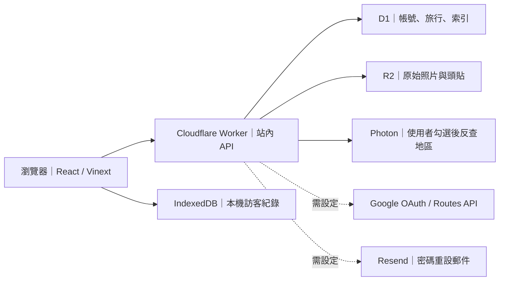
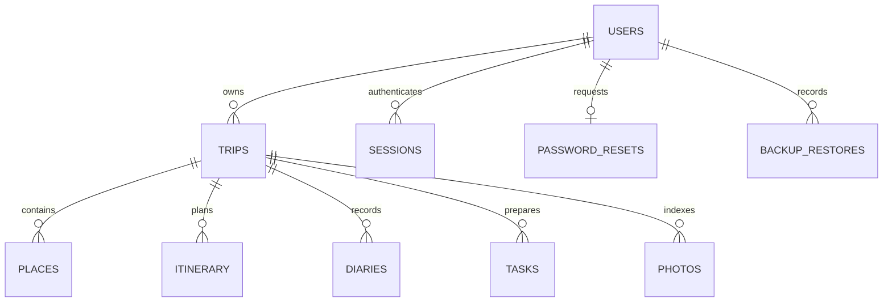

# 行旅錄｜專題發表材料

## 一句話

行旅錄把旅行前的行程、旅行中的照片與日記，以及旅行後的地圖回放放在同一個旅行手帳。

## 七頁簡報大綱

1. **問題**：旅行規劃、照片和心得分散，回家後難以還原當時的旅程。
2. **設計**：用一趟旅行連結每日行程、國家足跡、照片與日記。
3. **旅前**：用東京三日範本展示多站規劃、地圖定位、交通方案及備忘。
4. **旅中**：上傳 EXIF 樣本和無定位照片，展示自動分類與手動修正。
5. **旅後**：首頁足跡總覽、3D 地球、旅程回放及含原始照片的備份。
6. **架構與安全**：展示下方系統架構與 ER 圖，解釋 D1、R2、登入與後端資料歸屬的關係。
7. **驗證與限制**：報告自動測試、實際展示及尚待啟用的外部服務，說明下一步。

## 系統架構

## ER 圖

## 展示 Use Case

| 使用者 | 目標 | 路徑 |
|---|---|---|
| 訪客 | 體驗旅程規劃與回放 | 開東京範本 → 每日行程 → 回放旅程 |
| 登入者 | 整理旅遊照片 | 旅行相簿 → 上傳 → 檢查分類 → 修正 |
| 登入者 | 回顧一個國家 | 首頁國家足跡 → 選擇國家 → 旅行、照片或日記 |
| 登入者 | 搬移旅行資料 | 設定 → 資料管理 → 下載含照片備份 → 還原為副本 |
| 既有 Gmail 帳號 | 重新取得登入 | 設定寄信服務後重設密碼，或配置 Google 登入後授權 |

## 展示前核對

以本機東京範本展示 3D 開場及 2D 站點回放。若沒有可展示的國家足跡，先在本機建立一筆到訪日期早於今天的示範足跡。備份還原用測試旅行，並準備 JPEG、PNG 或 WebP。東京範本交通數值是示範估算。即時路線、實際寄信與 Google 授權須先完成服務設定及驗證。
